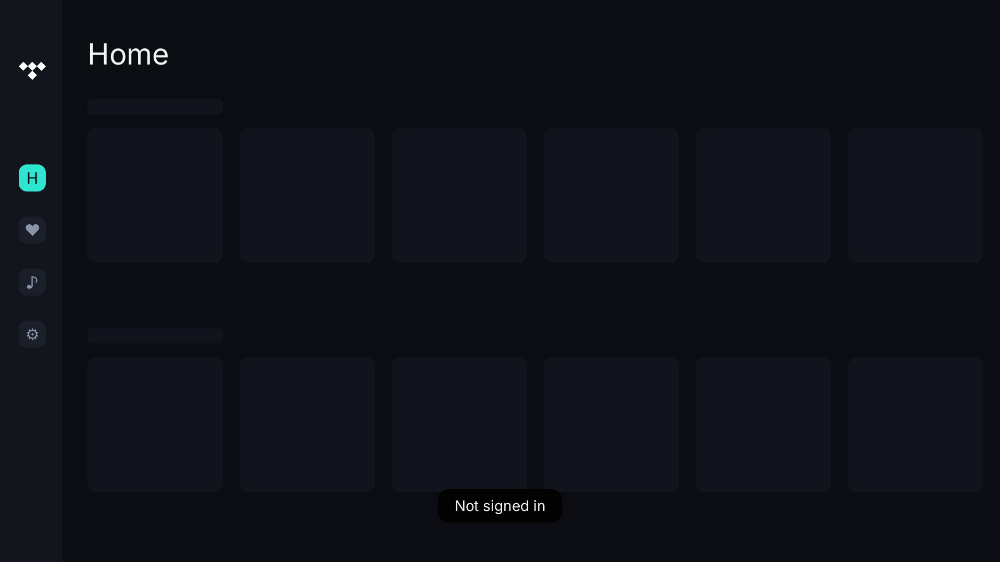

# tide-tv (M1 auth + first audio)

Native (no Chromium) music-client UI for LG webOS TVs: Rust + SDL2 + OpenGL ES 2.0,
drawn directly on the GPU. Login screen, Home, Liked songs, sidebar, player with synced lyrics.
Every screen talks to the real service through the `tidlers` crate, the only backend (there is
nothing to fall back to and no mock mode).
**M1** sign-in uses PKCE (QR, code, countdown), token refresh and a
persisted session: see `docs/auth.md`. The code comes back through a small
relay, so the phone can be on any network: see `docs/relay.md`. Sign-in uses the client named by `TIDAL_CLIENT_ID`/`TIDAL_CLIENT_SECRET`, which the TV and the relay both read: see `docs/auth.md`. **First cut of audio** (`tide-player`, SDL output): see `docs/audio.md`. TV build + `.ipk` packaging: see `docs/webos.md`.



## Run the simulator
```
sudo apt install libsdl2-dev libgles2-mesa-dev   # Debian/Ubuntu (+ Rust >= 1.88 via rustup)
make sim            # boots: restored session goes to Home, otherwise sign-in; F3 = fps HUD
make check          # unit tests (core is GPU-free)
```
`TIDAL_CLIENT_ID`/`TIDAL_CLIENT_SECRET` in `.env` are optional: without them the client embedded
in `tidlers` is used (see `docs/auth.md`).

Keys: arrows = D-pad, Enter = OK, Esc/Backspace = Back, Space/P = play/pause, F3 = HUD.
Edit `assets/theme.json` while the simulator runs: colours reload live.

Headless screenshots (CI / quick visual diff of the layout):
`cargo run -p tide-sdl -- --screen=home --keys=down,right,ok --screenshot=out.png`
(`--screen=` skips the boot, so it draws the empty skeleton rather than real content.)

## Layout
See ARCHITECTURE.md. Short version: `tide-core` (pure UI logic, testable) →
`DrawList` → `tide-gfx` (GLES renderer); `tide-api` (backend thread on `tidlers`);
`tide-sdl` (window/input/loop; the only SDL-aware crate).

## Not done / unverified (be honest with yourself)
* Everything TV-specific: NDK cross-build, `.ipk`, SDL on webOS, remote key codes,
  `packaging/appinfo.json` (copy the real fields from PlxNative's `ipkroot`/appinfo).
* Real fps on TV hardware. The simulator proves logic and look, not performance.
* Authentication has only been tested against fakes, never the real service (see `docs/auth.md`).
* The relay (`crates/tide-relay`) builds and is unit-tested, but the service has never been asked
  whether it accepts the relay's redirect for your client id (see `docs/relay.md`).
* Content (M2) and audio (M3). Check the service's terms before shipping.
* Font is DejaVu Sans (free licence, see `assets/fonts`). Pick your own later.

Covers and the quality indicator: see `docs/covers-and-quality.md`.
